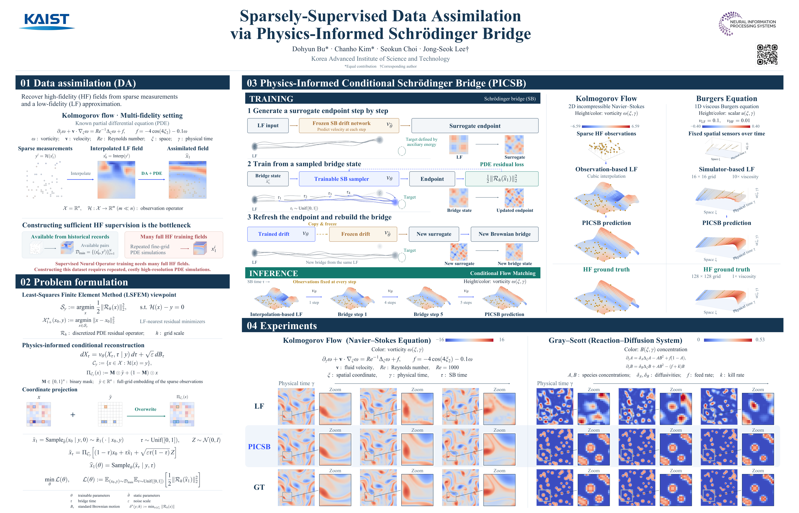
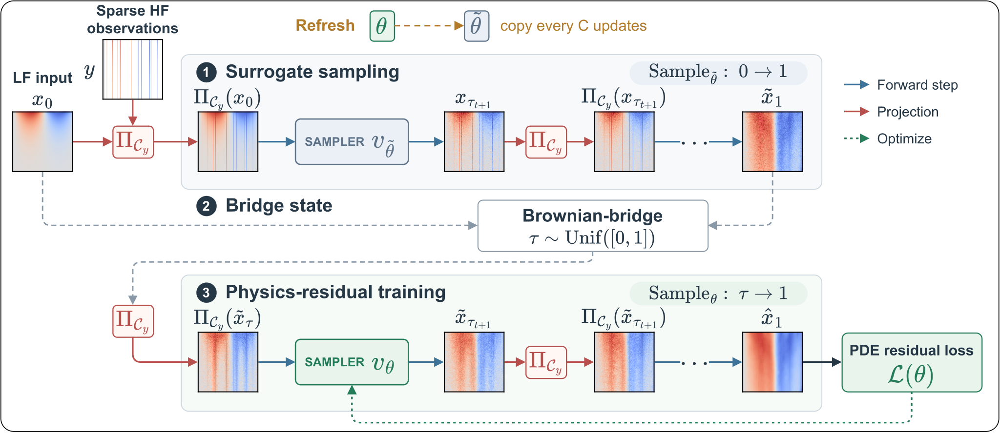

# Sparsely-Supervised Data Assimilation via Physics-Informed Schrödinger Bridge

This repository provides the implementation of the paper **"[Sparsely-Supervised Data Assimilation via Physics-Informed Schrödinger Bridge](https://openreview.net/forum?id=6WETopIg2t#discussion)"**.

<p align="center">
  <a href="./img/PICSB_POSTER.pdf">
    
  </a>
</p>

<p align="center">
  <a href="./img/architecture.pdf">
    
  </a>
</p>

---

### Table of Contents

1. [Installation](#installation)
2. [Usage](#usage)
   * [Training](#training)
   * [Inference](#inference)
   * [Log Output](#log-output)
   * [Parameter Settings](#parameter-settings)
3. [Scripts](#scripts)
4. [Dependencies](#dependencies)
5. [Datasets](#datasets)

---

## Installation

Clone this repository and install required packages:

```bash
git clone https://github.com/DohyunBu/PICSB.git
cd PICSB

conda create -n PICSB python=3.11.13 -y
conda activate PICSB
python -m pip install -r requirements.txt
```

Prepare the benchmark files described in [Datasets](#datasets) before running the scripts. Burgers data are generated automatically. Datasets and pretrained checkpoints are not included.

---

## Usage

### Training

Run the training script for each benchmark:

```bash
# Darcy Flow
python train_darcy.py --config_path config/darcy.yaml

# Kolmogorov Flow
python train_kolmo.py --config_path config/kolmo.yaml --fold-idx 0

# Reaction-Diffusion
python train_reaction_diffusion.py --config_path config/reaction_diffusion.yaml

# Gray-Scott
python train_gray.py --config_path config/gray.yaml

# Burgers' Equation (LF 16 or LF 32)
python train_burgers.py --config_path config/burgers.yaml --lf-grid 16
python train_burgers.py --config_path config/burgers.yaml --lf-grid 32
```

Darcy Flow, Kolmogorov Flow, Reaction-Diffusion, and Gray-Scott use the 10% sparse observation setting. Burgers uses 12 fixed spatial sensors. Checkpoints are saved under `Result/model/`:

| Benchmark | Checkpoint |
| :--- | :--- |
| Darcy Flow | `Result/model/darcy.pt` |
| Kolmogorov Flow (fold 0) | `Result/model/kolmo_fold0.pt` |
| Reaction-Diffusion | `Result/model/RD_100_10_1e7.pt` |
| Gray-Scott | `Result/model/gray_100_10_1e2_sparse.pt` |
| Burgers' Equation (LF 16) | `Result/model/burgers_16.pt` |
| Burgers' Equation (LF 32) | `Result/model/burgers_32.pt` |

For Kolmogorov Flow, `--fold-idx` selects one of five held-out folds (`0` to `4`). Use the same fold for training and inference. The scripts automatically append `_fold{index}` to the checkpoint name; an explicit inference `--model_path` is used as given.

Burgers uses a batch size of 8, `shuffle=False`, 100,000 training iterations, and `refresh=1` by default. Select the LF grid with `--lf-grid 16` or `--lf-grid 32` and use the same grid for inference.

`Finetune.py` provides additional finetuning for Darcy Flow, Kolmogorov Flow, and Burgers' equation. For example, after training Darcy Flow:

```bash
python Finetune.py --config_path config/darcy.yaml \
  --base_model_path Result/model/darcy.pt \
  --finetune_keep_ratios 1.0 0.5 0.1 \
  --save_dir Result/model_finetune \
  --model_name darcy_finetune.pt
```

### Inference

After training, run `test.py` with the corresponding configuration:

```bash
# Darcy Flow
python test.py --config_path config/darcy.yaml --regime sparse

# Kolmogorov Flow
python test.py --config_path config/kolmo.yaml --regime sparse --fold-idx 0 \
  --low_path benchmarks/kolmo/low_fidelity_10%_sparse.npy

# Reaction-Diffusion
python test.py --config_path config/reaction_diffusion.yaml --regime sparse

# Gray-Scott
python test.py --config_path config/gray.yaml --regime sparse

# Burgers' Equation (LF 16 or LF 32)
python test.py --config_path config/burgers.yaml --lf-grid 16 \
  --model_path Result/model/burgers_16.pt
python test.py --config_path config/burgers.yaml --lf-grid 32 \
  --model_path Result/model/burgers_32.pt
```

Darcy Flow, Kolmogorov Flow, Reaction-Diffusion, and Gray-Scott load the checkpoints listed above by default. For Burgers, specify `--model_path` as shown above; each command evaluates 40 test samples with a batch size of 4. Use `--model_path` to load a different checkpoint, `--save_dir` to change the output directory, and `--viz_dir` to save field visualizations:

```bash
python test.py --config_path config/darcy.yaml \
  --model_path Result/model/darcy.pt \
  --save_dir Result/infer/darcy \
  --viz_dir Result/infer_viz/darcy
```

Predictions, ground-truth fields, and observation masks are saved as `{dataset}_pred.pt`, `{dataset}_high_gt.pt`, and `{dataset}_mask.pt`. Kolmogorov outputs include the fold index, such as `kolmo_fold0_pred.pt`. Visualizations are saved as SVG files when `--viz_dir` is provided.

### Log Output

Training displays the iteration count and PDE loss. Inference reports **RMSE**, **MAE**, **relative L2 error**, and **fRMSE**.

To save the output to a log file:

```bash
mkdir -p logs
python train_darcy.py --config_path config/darcy.yaml 2>&1 | tee logs/train_darcy.log
python test.py --config_path config/darcy.yaml 2>&1 | tee logs/test_darcy.log
```

### Parameter Settings

Configurations are stored in `config/`. Training parameters can also be set through command-line arguments:

```bash
--config_path
--iterations
--batch-size
--steps
--base-lr
--beta-min
--beta-max
--time-dim
--refresh
--seed
--save-dir
--model-name
```

Example:

```bash
python train_darcy.py --config_path config/darcy.yaml \
  --iterations 10000 --batch-size 4 --steps 10 \
  --base-lr 1e-6 --seed 0 \
  --save-dir Result/model --model-name darcy.pt
```

Use `python train_darcy.py --help` or `python test.py --help` for the available options. Training uses `--save-dir` and `--model-name`; inference uses `--save_dir` and `--model_path`.

---

## Scripts

* **`models/model.py`**: Implements PICSB training and forward inference.
* **`models/networks.py`**, **`models/networks_3d.py`**: Define the 2D and 3D U-Net architectures and time conditioning.
* **`models/loss.py`**: Implements the PDE residual losses.
* **`models/data_generation.py`**, **`models/preprocessing.py`**: Provide observation masks, Burgers data generation, and interpolation.
* **`datasets/dataset.py`**: Loads low-fidelity fields, high-fidelity fields, and observation masks.
* **`train_*.py`**: Run training for the five supplied benchmark recipes, including `train_burgers.py` for LF grids of 16 or 32.
* **`test.py`**: Runs inference, computes metrics, and saves predictions.
* **`Finetune.py`**: Finetunes a trained model using additional observation sparsities.
* **`downsample.py`**: Prepares low-fidelity Kolmogorov and Gray-Scott data.
* **`models/metrics.py`**, **`models/visualize.py`**: Compute evaluation metrics and save field visualizations.
* **`utils.py`**: Handles configurations, dataset paths, masks, and data loaders.

The metric implementations in `models/metrics.py` are adapted from [REALPDEBENCH: A Benchmark for Complex Physical Systems with Real-World Data](https://arxiv.org/abs/2601.01829).

---

## Dependencies

The supplied environment uses **Python 3.11.13** and **PyTorch 2.5.1 with CUDA 12.1**. Use a CUDA-capable GPU for the training and finetuning recipes.

```text
torch==2.5.1+cu121
torchvision==0.20.1+cu121
torchaudio==2.5.1+cu121
numpy==1.26.4
scipy==1.13.1
tqdm==4.67.1
matplotlib==3.10.6
PyYAML==6.0.2
h5py
```

---

## Datasets

The supplied training scripts cover Darcy Flow, Kolmogorov Flow, Reaction-Diffusion, Gray-Scott, and Burgers' equation. Download and prepare the source data for the first four benchmarks as described below. Burgers data are generated by the training and inference scripts.

### Darcy Flow

Download `training/darcy/darcy_4.mat` from the [DiffusionPDE dataset](https://drive.google.com/drive/folders/1YbTCcBE6HlUuYNGuf2QVGfbmfTOi3_My). Extract `lognorm_a_data` and `lognorm_p_data`, select the same 80 instances from both arrays, and save each with shape `(80, 1, 128, 128)`:

```text
benchmarks/darcy/lognorm_a_data.npy
benchmarks/darcy/lognorm_p_data.npy
```

The scripts use the first 32 instances for training and instances 40 onward for testing. The intervening eight instances are reserved and are not used by the main training scripts. Low-fidelity pressure fields are constructed during training and inference.

### Kolmogorov Flow

Download [`kf_2d_re1000_256_40seed.npy`](https://figshare.com/ndownloader/files/39181919), provided with [Diffusion-based Fluid Super-resolution](https://github.com/BaratiLab/Diffusion-based-Fluid-Super-resolution), and place it at:

```text
benchmarks/kolmo/kf_2d_re1000_256_40seed.npy
```

Generate the low-fidelity data:

```bash
python downsample.py --dataset kolmo --regime sparse --sparsity 0.10 \
  --input benchmarks/kolmo/kf_2d_re1000_256_40seed.npy \
  --output benchmarks/kolmo/low_fidelity_10%_sparse.npy
```

The scripts select 40 trajectories and time indices `40:80`. Each fold uses 32 trajectories for training and eight for testing.

### Reaction-Diffusion

Download [`ReacDiff_Nu5.0_Rho5.0.hdf5`](https://darus.uni-stuttgart.de/api/access/datafile/133192) from PDEBench and place it at:

```text
benchmarks/RD/ReacDiff_Nu5.0_Rho5.0.hdf5
```

The scripts read the first 80 samples from `tensor`, select time indices `36:100`, and subsample the spatial dimension by a factor of 16. They construct sparse masks and low-fidelity fields automatically, using 32 samples for training and 40 for testing with eight reserved samples in between.

### Gray-Scott

Download the source data from [The Well: Gray-Scott Reaction-Diffusion](https://huggingface.co/datasets/polymathic-ai/gray_scott_reaction_diffusion). Select 80 instances with both species, downsample time and the two spatial dimensions to `64 x 64 x 64`, and save an array with shape `(80, 2, 64, 64, 64)` at:

```text
benchmarks/gray/gray_high_f_1d_down.npy
```

Generate the low-fidelity data and observation masks:

```bash
python downsample.py --dataset gray --regime sparse --sparsity 0.10 \
  --input benchmarks/gray/gray_high_f_1d_down.npy \
  --output benchmarks/gray/gray_low_f_1d_down_sparse.npy \
  --mask-output benchmarks/gray/gray_mask_high_1d_sparse.npy
```

The scripts use 32 samples for training and 40 for testing with eight reserved samples in between.

### Burgers' Equation

Burgers data generation is provided in `models/data_generation.py` and configured by `config/burgers.yaml`, following the setup described in [DiffusionPDE](https://arxiv.org/abs/2406.17763) and its [Burgers data generation code](https://github.com/jhhuangchloe/DiffusionPDE/tree/main/dataset_generation/burgers). `train_burgers.py` and `test.py` generate the data automatically; no dataset download or separate preprocessing command is required.

HF trajectories use viscosity `0.01` on a `128 x 128` space-time grid. LF trajectories use viscosity `0.1` on a `16 x 16` or `32 x 32` grid selected with `--lf-grid` (default: `16`), then are upsampled to the HF resolution using nearest-neighbor interpolation. The LF simulation starts from the initial HF frame sampled on the LF grid, and the two trajectories evolve independently. HF observations use 12 fixed spatial sensors shared across samples and time steps (`seed=0`), sampled separately from the HF reference.

Training uses the first 32 samples from 40 generated HF/LF pairs (HF seed `0`, LF seed `20`). Testing uses the last four pairs (`36:40`) plus 36 newly generated pairs (HF seed `1999`, LF seed `2026`), for 40 test samples that do not overlap with the training set.

---
